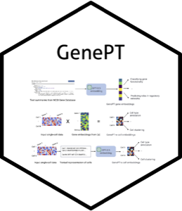
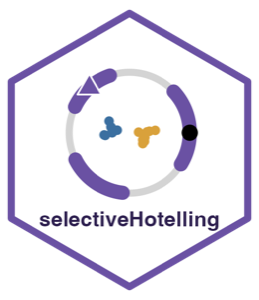
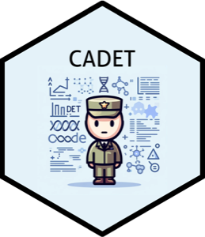
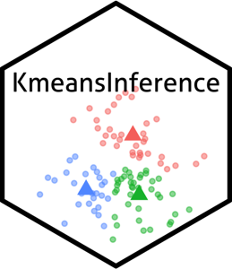
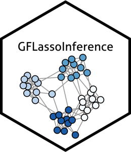
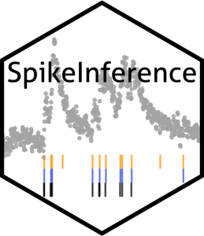

  

  
  
  
  

We are a data science group at Johns Hopkins, led by [Yiqun Chen](https://yiqunchen.github.io) in Biostatistics and Computer Science. We build statistical tools that make modern AI more trustworthy, and we use AI to speed up careful scientific data analysis.

### What we work on

| | |
|---|---|
| **AI agents for science** | Benchmarks and pipelines that test whether coding agents can do real scientific analysis, from spatial transcriptomics to causal effect estimation. |
| **Statistics for AI** | Valid inference for LLM-as-a-judge evaluation, prediction-powered inference, and power analysis for AI-assisted studies. |
| **LLMs for biology and health** | Language model embeddings for single-cell genomics (GenePT), perturbation prediction, and verbal autopsy for global health. |
| **Selective inference** | Valid p-values for hypotheses that come from the data itself, such as testing after clustering or changepoint detection. |

### Software

  
  
  
  
  
  

### Recent highlights

- **[Mind the Alignment Gap](https://www.biorxiv.org/content/10.64898/2026.07.05.736638v1)**, a spatial transcriptomics benchmark for coding agents, is an oral at MLCB 2026. Code: [`spatial-alignment-agent`](https://github.com/Y-Chen-LAB/spatial-alignment-agent).
- **[InferenceEvolve](https://arxiv.org/abs/2604.04274)**, self-evolving AI for automated causal effect estimation, was accepted to NeurIPS 2026.
- **[Efficient Inference for Noisy LLM-as-a-Judge Evaluation](https://arxiv.org/abs/2601.05420)** was accepted to ICML 2026.
- **[Power Analysis for Prediction-Powered Inference](https://arxiv.org/abs/2603.16041)** comes with an [online sample size calculator](https://yiqunchen.github.io/pppower/articles/sample-size-calculator.html).
- **[GenePT](https://www.nature.com/articles/s41551-024-01284-6)** appeared in *Nature Biomedical Engineering*.

### Join us

We are always happy to hear from students and collaborators who care about rigorous, useful data science. Email **yiqun.t.chen@gmail.com**.
